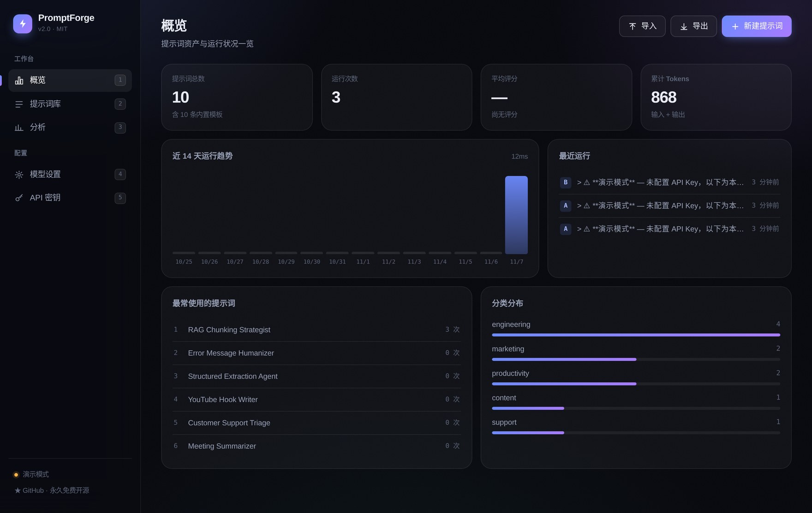
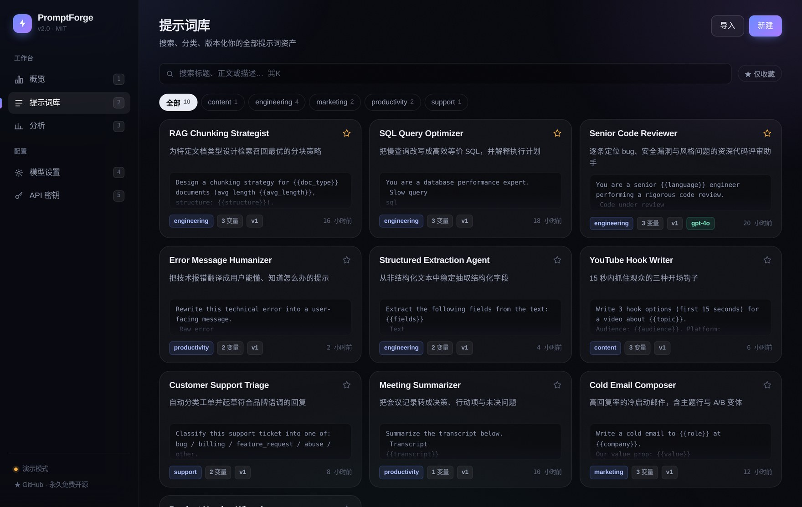
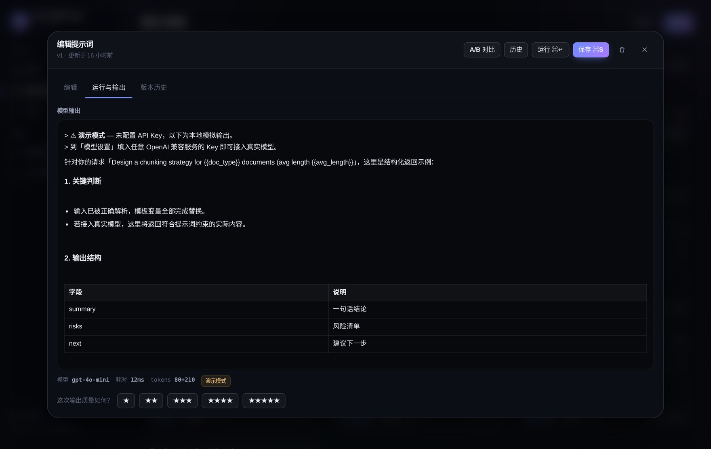
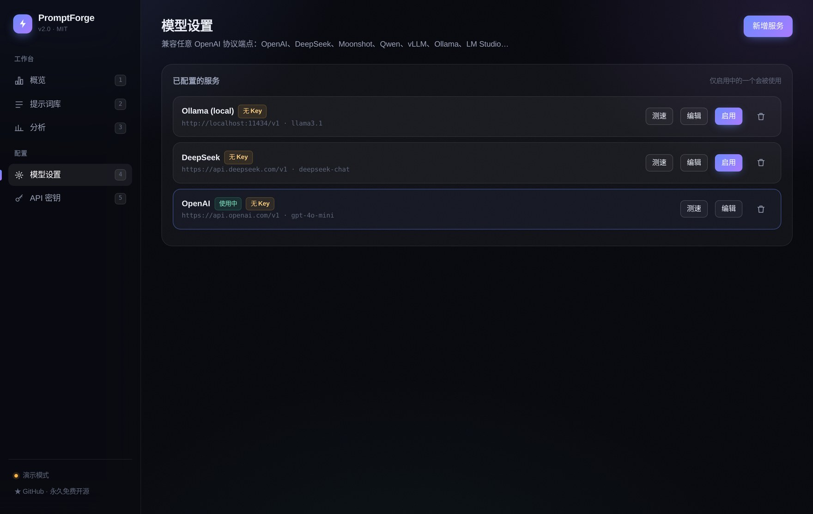

<div align="center">

# ⚡ PromptForge

**提示词工程工作台 — 把提示词当代码来管理、评测和交付**

[](https://github.com/wangzi5151/promptforge/actions/workflows/ci.yml)
[](LICENSE)
[](https://www.python.org)
[](https://fastapi.tiangolo.com)
[](Dockerfile)
[](CONTRIBUTING.md)

[功能](#-功能) · [快速开始](#-快速开始) · [接入模型](#-接入任意模型) · [API](#-rest-api) · [架构](#-架构) · [路线图](#-路线图)

</div>

---

## 为什么需要它

大多数团队把提示词散落在聊天记录、Notion 页面和代码注释里。改了哪一版、为什么改、新版到底更好还是更差——**没人知道**。

PromptForge 把提示词变成**可版本化、可运行、可评测**的资产：

- 改一个字就自动留档，随时比对任意两个版本的 diff
- 一键把模板发给真实模型，看实际输出而不是脑补
- 给每次输出打分，让"这个提示词好不好"变成可量化的数字
- 同一组变量并排跑 A/B 两个变体，用结果而不是偏好做决定

## 📸 界面预览

<table>
<tr>
<td width="50%"></td>
<td width="50%"></td>
</tr>
<tr>
<td></td>
<td></td>
</tr>
</table>

## ✨ 功能

<table>
<tr>
<td width="50%" valign="top">

**编写与管理**
- `{{变量}}` 模板语法，自动识别、按出现顺序排列
- 分类、标签、收藏、全文搜索
- 版本历史：每次正文变更自动生成新版本
- 版本 diff（逐行高亮）与一键回滚
- JSON 一键导入 / 导出，数据完全归你

**运行与评测**
- 兼容任意 OpenAI 协议端点
- 流式输出（SSE），打字机效果
- A/B 对比：同一组变量跑两个变体，并排看结果
- 每次运行记录模型、延迟、token 用量
- 1–5 星评分回写，驱动统计面板

</td>
<td width="50%" valign="top">

**洞察**
- 14 天运行趋势
- 热门提示词排行（运行次数 + 平均分）
- 分类分布
- 平均延迟、累计 token 消耗

**工程化**
- FastAPI + SQLite，单进程零外部依赖
- 前进式数据库迁移，升级不丢数据
- 可选 API Key 鉴权（`PROMPTFORGE_REQUIRE_KEY=1`）
- 24 个自动化测试，CI 覆盖 Python 3.10–3.12 + Docker 构建
- 暗色玻璃拟态界面，键盘优先

</td>
</tr>
</table>

## 🚀 快速开始

```bash
git clone https://github.com/wangzi5151/promptforge.git
cd promptforge
pip install -r requirements-dev.txt
make run          # → http://localhost:8000
```

首次启动会自动建库并注入 **10 条生产级提示词模板**（代码评审、SQL 优化、RAG 分块、结构化抽取…），开箱即用。

<details>
<summary><b>Docker 部署（推荐生产环境）</b></summary>

```bash
docker compose up -d --build
# → http://localhost:8000
```

数据持久化在 `promptforge-data` 卷中。
</details>

<details>
<summary><b>配置项</b></summary>

| 环境变量 | 默认值 | 说明 |
|---|---|---|
| `PROMPTFORGE_DB` | `./promptforge.db` | SQLite 数据库路径 |
| `PROMPTFORGE_HOST` | `0.0.0.0` | 监听地址 |
| `PROMPTFORGE_PORT` | `8000` | 监听端口 |
| `PROMPTFORGE_REQUIRE_KEY` | `0` | 设为 `1` 时，写操作需要 `X-API-Key` |
</details>

## 🔌 接入任意模型

打开 **模型设置**，填入任意 OpenAI 兼容服务的 Base URL 与 Key：

| 服务 | Base URL | 示例模型 |
|---|---|---|
| OpenAI | `https://api.openai.com/v1` | `gpt-4o-mini` |
| DeepSeek | `https://api.deepseek.com/v1` | `deepseek-chat` |
| Moonshot | `https://api.moonshot.cn/v1` | `moonshot-v1-8k` |
| 阿里云百炼 | `https://dashscope.aliyuncs.com/compatible-mode/v1` | `qwen-plus` |
| Ollama（本地） | `http://localhost:11434/v1` | `llama3.1` |
| vLLM / LM Studio | 你的地址 | 你的模型 |

> **不配 Key 也能跑。** 未配置时自动进入「演示模式」，用确定性的本地模拟输出，方便先体验完整流程。

## 📡 REST API

启动后访问 **`/docs`** 获取交互式 Swagger 文档。

```bash
# 创建
curl -X POST http://localhost:8000/api/prompts \
  -H "Content-Type: application/json" \
  -d '{"title":"翻译助手","body":"将以下 {{lang}} 文本翻译成中文：{{text}}"}'

# 渲染 + 调用模型
curl -X POST http://localhost:8000/api/prompts/{id}/run \
  -H "Content-Type: application/json" \
  -d '{"variables":{"lang":"English","text":"hello"},"call_llm":true}'

# 流式（SSE）
curl -N -X POST http://localhost:8000/api/prompts/{id}/stream \
  -d '{"variables":{"lang":"English","text":"hello"}}'
```

<details>
<summary><b>完整端点列表</b></summary>

| 方法 | 路径 | 说明 |
|---|---|---|
| `GET` | `/api/health` | 健康检查与模型就绪状态 |
| `GET` | `/api/prompts` | 列表（`?q=&category=&tag=&favorites=`） |
| `POST` | `/api/prompts` | 创建 |
| `GET` | `/api/prompts/{id}` | 详情 |
| `PATCH` | `/api/prompts/{id}` | 更新（正文变更自动升版本） |
| `DELETE` | `/api/prompts/{id}` | 删除（级联清理版本与运行记录） |
| `POST` | `/api/prompts/{id}/favorite` | 切换收藏 |
| `GET` | `/api/prompts/{id}/versions` | 版本列表 |
| `POST` | `/api/prompts/{id}/versions/{v}/restore` | 回滚到指定版本 |
| `GET` | `/api/prompts/{id}/versions/{v}/diff` | 版本 diff |
| `POST` | `/api/prompts/{id}/run` | 渲染并（可选）调用模型 |
| `POST` | `/api/prompts/{id}/stream` | SSE 流式输出 |
| `POST` | `/api/prompts/{id}/compare` | A/B 双变体对比 |
| `GET` | `/api/runs` · `/api/prompts/{id}/runs` | 运行记录 |
| `POST` | `/api/runs/{id}/score` | 评分 1–5 |
| `GET` | `/api/analytics` | 聚合统计 |
| `GET/POST/DELETE` | `/api/providers` | 模型服务配置 |
| `POST` | `/api/providers/{id}/ping` | 连通性测试 |
| `GET/POST/DELETE` | `/api/api-keys` | API 密钥 |
| `GET/POST` | `/api/export` · `/api/import` | 全量导入导出 |

</details>

## 🏗 架构

```
app/
├── main.py      FastAPI 路由层（含 SSE 流式、A/B 对比、鉴权依赖）
├── db.py        SQLite 数据层：WAL、线程局部连接、前进式迁移
├── llm.py       OpenAI 协议客户端（标准库 urllib，无额外依赖）+ 离线模拟
├── config.py    环境变量配置
└── static/      无构建 SPA
    ├── index.html
    ├── app.css   设计系统：暗色玻璃拟态
    └── app.js    路由、渲染、SSE、Markdown、diff
tests/           24 个 pytest 用例
```

**技术取舍：** 单进程 FastAPI + SQLite，不需要 Postgres、Redis 或 Node 构建链。一个 `pip install` 就能跑，Docker 镜像不到 200MB。这是自托管工具最合理的形态——**部署成本应该趋近于零**。

## 🗺 路线图

- [x] 提示词 CRUD / 版本 / diff / 回滚
- [x] 变量模板与实时渲染
- [x] OpenAI 协议接入 + 流式输出
- [x] A/B 对比与评分回写
- [x] 分析面板
- [ ] 提示词评分的历史趋势曲线
- [ ] 批量评测数据集（golden set）跑分
- [ ] MCP Server 模式：把提示词库暴露给任意 Agent
- [ ] 多用户与团队工作区
- [ ] 中文 / 英文双语界面

## 🤝 贡献

欢迎 Issue 与 PR，见 [CONTRIBUTING.md](CONTRIBUTING.md)。`make test` 全绿即可。

## 📄 许可

[MIT](LICENSE) © 2026 PromptForge contributors

<div align="center">
<sub>如果这个项目对你有帮助，欢迎点一个 ⭐</sub>
</div>
